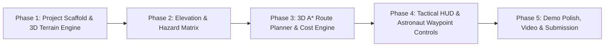

# 📋 AresPath AI — Step-by-Step Implementation Guide & Roadmap

This guide walks through the exact phases to build the Proof of Concept (PoC) into a functional hackathon submission.

---

## 📅 Roadmap Overview

---

## 🛠️ Phase 1: 3D Terrain Mesh & Rendering Engine

### Objectives:
1. Initialize a modern, fast **Vite + React + TypeScript** project with **Three.js** (`@react-three/fiber` & `@react-three/drei` or pure `Three.js` canvas).
2. Generate a dynamic 3D Martian surface mesh from a grayscale heightmap / Digital Elevation Model (DEM) array.
3. Apply realistic Martian PBR textures (albedo/color, roughness, normal maps) and dynamic sun illumination.

### Key Files:
- `src/engine/TerrainMesh.ts`: Converts 2D heightmap matrix into Three.js `PlaneGeometry` vertex displacement with normal vectors.
- `src/engine/Lighting.ts`: Directional sunlight matching Martian solar elevation angles.

---

## 📊 Phase 2: Hazard Segmentation & Traversability Cost Function

### Objectives:
1. Calculate the gradient / slope at every $(x, y)$ coordinate on the terrain grid:
   $$\text{Slope angle } \theta = \arccos\left(\frac{\vec{n}_z}{\|\vec{n}\|}\right)$$
2. Classify terrain safety levels:
   * 🟢 **Safe ($< 8^\circ$):** Nominal speed / low energy cost.
   * 🟡 **Caution ($8^\circ - 15^\circ$):** Elevated energy cost / moderate rover slip risk.
   * 🔴 **No-Go Hazard ($> 15^\circ$ or boulder fields):** Impassable terrain / steep crater cliffs.
3. Generate a dynamic visual **Traversability Overlay** (toggleable green/yellow/red heatmap on the 3D surface).

---

## 🧭 Phase 3: 3D A* Pathfinding Engine

### Objectives:
1. Implement a 3D grid-based $A^*$ algorithm in TypeScript.
2. Formulate the movement cost between neighbor nodes:
   $$\text{StepCost}(u, v) = \text{EuclideanDist}(u, v) \times \left(1 + 5 \cdot \text{SlopeFactor}(u, v) + \text{HazardPenalty}(v)\right)$$
3. Ensure the algorithm dynamically routes around crater rims and boulder clusters, finding the most energy-efficient route.
4. Render the calculated route as a glowing neon cyan 3D spline directly onto the terrain.

---

## 🧑‍🚀 Phase 4: Astronaut Tactical EVA HUD & Telemetry

### Objectives:
1. **Interactive Waypoint Pinning:** Allow the user to click any two spots on the 3D terrain to set `Start (Base/Lander)` and `Destination (Science Outpost)`.
2. **Real-Time Telemetry Dashboard:**
   * Total Traverse Distance (km / meters).
   * Cumulative Elevation Gain / Loss.
   * Estimated EVA Duration & Oxygen / Battery consumption.
   * Direct Line-of-Sight (LOS) communication beacon status with Base/Earth.
3. **Camera Modes:**
   * **Orbital Tactical View:** Free orbit/pan/zoom inspection.
   * **Astronaut First-Person / Follow View:** Animates an astronaut/rover marker traveling along the calculated route.

---

## 🎬 Phase 5: Submission & Presentation Strategy

1. **GitHub Repository:** Clean code, modular TypeScript architecture, MIT License.
2. **Live Web Demo:** Deployed instantly to Cloudflare Pages / Vercel for judges to interact with live.
3. **30–90 Second Demo Video:**
   - Hook: The danger of Martian EVAs and limitations of 2D maps.
   - Core Demo: 3D terrain load $\rightarrow$ Hazard heatmap toggle $\rightarrow$ Instant safe A* route generation with elevation graph.
   - Impact: Enhancing safety for Artemis & future human Mars missions.
