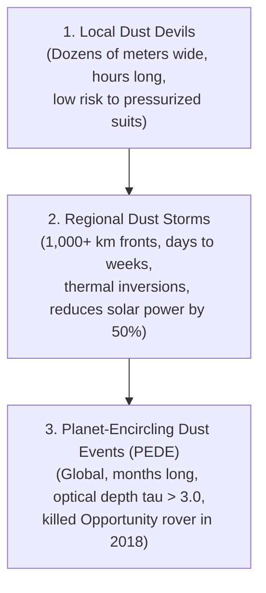

# 🌪️ Martian Weather, Atmosphere & Radiation Hazards

A technical reference on the physical environment of Mars, public meteorological datasets from surface landers and orbiters (**Perseverance MEDA, Curiosity REMS, InSight TWINS, MAVEN, and Hope EMIRS**), and real-time hazard evaluation algorithms for **AresPath AI**.

---

## 🌡️ 1. The Physics of the Martian Environment

Martian extravehicular operations (EVAs) occur within an environment lethal to unprotected human physiology:

* **Atmospheric Pressure:**
  * Mean surface pressure is **$\sim 610\text{ Pa}$ ($6.1\text{ mbar}$ / $0.088\text{ psi}$)** — merely $0.6\%$ of Earth's sea-level pressure ($101.3\text{ kPa}$).
  * Well below the **Armstrong Limit** ($\sim 6.3\text{ kPa}$), meaning bodily fluids would vaporize at normal body temperature without a pressurized space suit.
* **Atmospheric Composition:**
  * $95.32\%\text{ CO}_2$, $2.6\%\text{ N}_2$, $1.9\%\text{ Ar}$, $0.13\%\text{ O}_2$, $0.08\%\text{ CO}$.
* **Diurnal Surface Temperature Extremes:**
  * Equatorial Summer Day: $+20^\circ\text{C}$ ($+68^\circ\text{F}$) at ground level.
  * Nighttime Low: Drops precipitously to **$-100^\circ\text{C}$ to $-125^\circ\text{C}$** due to the ultra-thin atmosphere's inability to retain heat.
  * *EVA Rule:* Astronaut suits and rovers face rapid thermal cycling and severe battery drain during twilight/night transitions.
* **Surface Gravity:**
  * **$0.376\text{ g}$ ($3.72\text{ m/s}^2$)** — ~38% of Earth gravity. Allows carrying heavier life-support packs, but changes slope friction and footing dynamics.
* **Radiation Environment:**
  * Mars lacks a global intrinsic dipole magnetic field and has a very thin atmospheric shielding column ($\sim 20\text{ g/cm}^2$ vs Earth's $1000\text{ g/cm}^2$).
  * **Galactic Cosmic Rays (GCR):** Steady background dose of $\sim 0.5\text{ to }1.0\text{ mSv/day}$ (300–400 times Earth background).
  * **Solar Particle Events (SPE / Coronal Mass Ejections):** Sudden, unpredictable proton flux events delivering lethal doses ($> 1\text{ to }5\text{ Sv}$) within hours if unshielded.

---

## 📡 2. Active Surface Weather Stations & Telemetry Feeds

### A. Mars 2020 Perseverance — MEDA (Mars Environmental Dynamics Analyzer)
The MEDA suite on Perseverance is the most advanced weather station operating on Mars.

* **Sensors:**
  1. **ATS (Air Temperature Sensors):** 5 sensors positioned along the rover mast and body measuring thermal boundary layer gradients from 0.8 m to 1.5 m.
  2. **TIRS (Thermal Infrared Sensor):** Pointed at ground and sky to measure surface ground temperature and infrared radiance.
  3. **PS (Pressure Sensor):** High-precision silicon piezoresistive transducer reading barometric pressure with sub-Pascal accuracy.
  4. **WS (Wind Sensors):** Two booms on the mast measuring 3D wind speed (0 to 40 m/s) and azimuth direction.
  5. **HS (Humidity Sensor):** Relative humidity measurements tracking diurnal frost/sublimation cycles.
  6. **RDS (Radiation and Dust Sensor):** 16 photodiodes measuring solar radiation intensity and direct optical depth ($\tau$) of atmospheric dust.

#### Sample Live MEDA Telemetry Schema (PDS Format):
```json
{
  "sol": 920,
  "terrestrial_date": "2023-09-22T14:32:00Z",
  "local_true_solar_time": "13:45:12",
  "atmospheric_pressure_pa": 742.3,
  "air_temperature_celsius": {
    "min": -81.2,
    "max": -14.6,
    "mean": -48.1
  },
  "ground_temperature_celsius": {
    "min": -88.4,
    "max": 18.2,
    "mean": -32.5
  },
  "wind_speed_mps": 6.8,
  "wind_direction_degrees": 234.0,
  "dust_opacity_tau": 0.42,
  "uv_radiation_flux_index": "MODERATE"
}
```

### B. MSL Curiosity — REMS (Rover Environmental Monitoring Station)
Curiosity has gathered continuous weather logs inside Gale Crater since August 2012 (>4,000 Sols).

* **PDS Access:** Available via the PDS Atmospheres Node: [https://pds-atmospheres.nmsu.edu/](https://pds-atmospheres.nmsu.edu/)
* **Significance:** Long-term multi-year Martian seasonal cycles (Mars Year 31 through Mars Year 38).

### C. InSight Lander — TWINS (Temperature and Wind for InSight)
* Operated in Elysium Planitia, recording micro-barometric vortex signatures (dust devils) and seasonal atmospheric oscillation waves.

---

## 🌪️ 3. Dust Storm Classification & Operational Impact

Dust is the primary dynamic hazard on Mars. It coats solar panels, scatters communication signals, drops daytime ambient temperatures, and reduces optical navigation visibility to near zero.



### Optical Depth ($\tau$) Hazard Scaling for AresPath AI:
* **$\tau < 0.5$ (Nominal / Clear Skies):** Full optical navigation, standard EVA radius permitted.
* **$0.5 \le \tau < 1.0$ (Moderate Dust):** Increased light scattering, visual landmarks obscured at $> 500\text{ m}$.
* **$1.0 \le \tau < 2.5$ (Severe Storm Front):** Restrict EVA radius to 200 m from Habitat; initiate rover auxiliary heating.
* **$\tau \ge 2.5$ (Global PEDE Event):** **Immediate EVA Abort / Shelter Protocol.**

---

## ☢️ 4. Astronaut Radiation & Solar Particle Event (SPE) Shielding

AresPath AI integrates orbital space weather telemetry from **MAVEN** and **ESA TGO**:

### Real-Time Hazard Thresholds:
| Radiation Level | Dose Rate | Action Required |
| :--- | :---: | :--- |
| **GCR Background** | $< 0.05\text{ mSv/hr}$ | Nominal EVA operations. |
| **Elevated Solar Activity**| $0.05 - 0.5\text{ mSv/hr}$ | Restrict mission time; monitor solar sensors. |
| **Solar Particle Event (SPE)** | **$> 10.0\text{ mSv/hr}$** | **CRITICAL ABORT.** Seek subterranean lava tube, regolith storm shelter, or habitat safe room immediately. |

---

## 🐍 5. Python Ingestion Engine for Weather Telemetry

```python
import requests

def fetch_martian_surface_weather(sol=None):
    """
    Simulated ingestion pipeline fetching daily Mars surface weather
    using the NASA Mars InSight / Perseverance open data API.
    """
    url = "https://mars.nasa.gov/rss/api/?feed=weather&category=msl&feedtype=json"
    try:
        response = requests.get(url, timeout=10)
        data = response.json()
        sol_data = data.get("soles", [])[0]
        
        weather_report = {
            "sol": sol_data.get("sol"),
            "earth_date": sol_data.get("terrestrial_date"),
            "temp_air_min_c": sol_data.get("min_temp"),
            "temp_air_max_c": sol_data.get("max_temp"),
            "pressure_pa": sol_data.get("pressure"),
            "atmosphere": sol_data.get("atmo_opacity")
        }
        return weather_report
    except Exception as e:
        print(f"Error connecting to Mars weather service: {e}")
        return None

if __name__ == "__main__":
    report = fetch_martian_surface_weather()
    print("Latest Surface Weather Feed for AresPath AI:")
    print(report)
```
