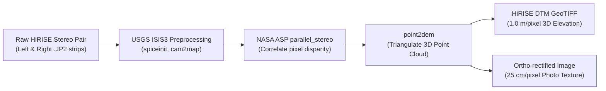

# 🏔️ 3D Terrain Reconstruction & Photogrammetric Stitching Pipeline

A comprehensive technical blueprint for overcoming the **Martian 3D Resolution Gap** by reconstructing, stitching, and rendering high-fidelity 3D terrain meshes using **NASA Ames Stereo Pipeline (ASP), USGS ISIS3, Structure-from-Motion (SfM), and 3D Gaussian Splatting (3DGS)** for the **AresPath AI** navigation tactical HUD.

---

## 🔍 1. The Mars 3D Resolution Problem

Global Mars 3D models available online suffer from a critical limitation for human exploration:

| Dataset / Source | Spatial Resolution | Vertical Accuracy | Operational Limitation for Astronauts |
| :--- | :---: | :---: | :--- |
| **Global MGS MOLA DEM** | **~463 m / pixel** | $\sim 1\text{ meter}$ | **Completely blind to micro-terrain.** A 463 m cell flattens out 10-meter cliffs, crevasses, rock fields, and dune slip-faces. |
| **Mars Express HRSC DTM** | **50 m / pixel** | $\sim 10\text{ meters}$ | Good for regional mountain ranges, but cannot detect boulders or human-scale obstacles. |
| **MRO CTX Stereo DTM** | **18–20 m / pixel** | $\sim 2\text{ meters}$ | Regional valley floors and crater rims. |
| **MRO HiRISE Stereo DTM** | **1.0–2.0 m / pixel** | **$\sim 0.2\text{ meters}$** | **The Gold Standard for EVA.** Captures individual boulders, gullies, sand dunes, and steep slope breaks. |
| **Rover Mastcam/Navcam** | **Centimeter / Millimeter** | Sub-centimeter | Local ground-truth immediately surrounding the landing/hab site ($< 500\text{ m}$). |

> **The AresPath Solution:** We do not rely on standard static globes. Instead, we implement a **hierarchical multi-scale terrain pipeline**:
> 1. Macro-scale background: MOLA + HRSC (50–463 m).
> 2. Tactical EVA sector: HiRISE / CTX stereo photogrammetric DTMs (1–2 m).
> 3. Micro-scale habitat zone: Rover ground-level panoramic reconstruction via Structure-from-Motion / 3D Gaussian Splatting.

---

## 🛠️ 2. The Orbital Stereo Pipeline: NASA Ames Stereo Pipeline (ASP)

The **NASA Ames Stereo Pipeline (ASP)** is an open-source, automated stereogrammetry system developed by the NASA Intelligent Robotics Group (IRG) to generate high-resolution DTMs and ortho-images from satellite stereo pairs.



### Complete Workflow: From PDS Orbit to 3D GeoTIFF

#### Step 1: Install Ames Stereo Pipeline & USGS ISIS3
```bash
# ASP is distributed as precompiled binaries via Conda or direct tarball:
conda create -n stereo-pipeline -c conda-forge stereopipeline python=3.10
conda activate stereo-pipeline
```

#### Step 2: Download a Verified HiRISE Stereo Pair
HiRISE stereo pairs consist of two images taken of the same ground coordinate from two different orbital passes at slightly different angles ($\sim 10^\circ - 20^\circ$ convergence angle).
* Example pair over Jezero Crater:
  * Left Image: `PSP_001414_1750_RED.JP2`
  * Right Image: `PSP_002165_1750_RED.JP2`

#### Step 3: Run Automated Stereo Matching & Triangulation
```bash
# 1. Run parallel stereo correlation across all available CPU threads
parallel_stereo --stereo-algorithm mGM \
  PSP_001414_1750_RED.JP2 PSP_002165_1750_RED.JP2 \
  output_jezero/run

# 2. Convert the resulting 3D point cloud into a georeferenced GeoTIFF DEM
point2dem output_jezero/run-PC.tif \
  --dem-spacing 1.0 \
  --t_srs "+proj=eqc +lat_ts=0 +lat_0=0 +lon_0=0 +x_0=0 +y_0=0 +a=3396190 +b=3396190 +units=m +no_defs" \
  -o output_jezero/jezero_hirise_1m_dem.tif
```
* **Result:** A true **1.0 meter/pixel Digital Elevation Model (DEM)** with absolute elevation values in meters relative to the Mars Areoid datum.

---

## 🤖 3. Ground-Level Reconstruction: Rover Imagery to 3D Mesh

When astronauts walk near the Habitat or a landing site, orbital imagery can be augmented with rover ground-level camera sequences (Perseverance Mastcam-Z, Navcams, Hazcams).

### A. Structure-from-Motion (SfM) via COLMAP
1. Extract overlapping images taken during a rover drive stop or 360-degree panorama.
2. Detect feature keypoints (SIFT) and match across adjacent camera angles.
3. Compute bundle adjustment to triangulate sparse 3D point cloud and camera poses.
4. Run Dense Multi-View Stereo (MVS) to output a detailed `.ply` / `.obj` 3D mesh.

```bash
# Run dense reconstruction on rover Navcam sequence:
colmap feature_extractor --image_path ./rover_navcam_images --database_path database.db
colmap exhaustive_matcher --database_path database.db
colmap mapper --database_path database.db --image_path ./rover_navcam_images --output_path ./sparse
colmap image_undistorter --image_path ./rover_navcam_images --input_path ./sparse/0 --output_path ./dense
colmap dense_stereo --workspace_path ./dense
colmap dense_fuser --workspace_path ./dense --output_path ./dense/fused_martian_rock.ply
```

### B. 3D Gaussian Splatting (3DGS) for Real-Time EVA HUDs
Modern neural radiance and radiance splatting pipelines (3DGS) allow converting a 20-photo sequence of an outcrop or boulder field into real-time, 60 FPS navigable 3D scenes:
* High-frequency micro-textures (fractured basalt, regolith crust).
* Sub-millisecond rendering speed on client GPUs (using WebGL / WebGPU rasterizers).

---

## 🧠 4. Monocular Depth Super-Resolution via Foundation Models

What if an area only has a **single 25 cm/pixel HiRISE image** and **no stereo pair**?

AresPath AI can deploy a deep-learning **Monocular Depth Super-Resolution pipeline**:
1. Take a low-res MOLA/HRSC base heightmap (50m grid).
2. Input the high-res 25 cm/pixel HiRISE single-channel panchromatic image.
3. Use a pre-trained metric monocular depth estimation network (such as **Metric3D v2** or **Marigold**) fine-tuned on synthetic Martian lighting models to predict relative micro-relief:
   $$z_{\text{high}} = z_{\text{base}} + \Delta z_{\text{AI}}$$
4. Generate a high-frequency displacement map that accurately models individual boulder heights and crater depths without needing a second orbital pass.

---

## 🌐 5. Web-Ready 3D Terrain Packaging (CesiumJS & Three.js)

To stream massive gigabyte-scale Martian 3D DTMs smoothly into a browser interface, the raw GeoTIFF must be converted into tiled heightmaps:

### Option A: Quantized Mesh (`.terrain`) for CesiumJS
Cesium uses the **Quantized Mesh** specification, which stores multi-LOD (Level-of-Detail) TIN (Triangulated Irregular Network) tiles:
```bash
# Convert GeoTIFF DTM into Cesium Quantized Mesh tiles using open-source ctb-tile:
ctb-tile -o ./tilesets/jezero_terrain -s 14 -e 8 jezero_hirise_1m_dem.tif
```

### Option B: Mapbox Terrain-RGB Heightmap Encoding
Encode elevation into a standard 24-bit PNG where height $h$ in meters is computed from RGB channels:
$$h = -10000 + (R \times 256 \times 256 + G \times 256 + B) \times 0.1$$

#### Python Script: GeoTIFF to Terrain-RGB PNG Converter
```python
import numpy as np
import rasterio
from PIL import Image

def geotiff_to_terrain_rgb(geotiff_path, output_png_path):
    with rasterio.open(geotiff_path) as src:
        elevation = src.read(1)
        # Replace nodata values with minimum elevation
        nodata = src.nodata
        if nodata is not None:
            elevation[elevation == nodata] = np.nanmin(elevation)
            
        # Normalize and pack into 24-bit RGB
        # Height offset = 10,000m; Precision = 0.1m
        encoded = np.clip((elevation + 10000.0) * 10.0, 0, 16777215).astype(np.uint32)
        
        r = ((encoded >> 16) & 0xFF).astype(np.uint8)
        g = ((encoded >> 8) & 0xFF).astype(np.uint8)
        b = (encoded & 0xFF).astype(np.uint8)
        
        rgb_array = np.dstack((r, g, b))
        img = Image.fromarray(rgb_array, mode='RGB')
        img.save(output_png_path, "PNG")
        print(f"Encoded {geotiff_path} -> {output_png_path} (Terrain-RGB format)")

if __name__ == "__main__":
    # Converts sample elevation GeoTIFF into web-streamable PNG tile
    # geotiff_to_terrain_rgb("sample_dem.tif", "sample_terrain_rgb.png")
    pass
```

### Option C: Exporting to Three.js glTF / GLB 3D Meshes
For localized 3D tactical models (e.g., a $1\text{ km} \times 1\text{ km}$ EVA sector around the Habitat):
* Sample the elevation matrix into a regular grid.
* Generate vertex normals for realistic Martian solar shadowing.
* Export directly to binary `.glb` with embedded HiRISE color texture for zero-dependency rendering in Three.js.
